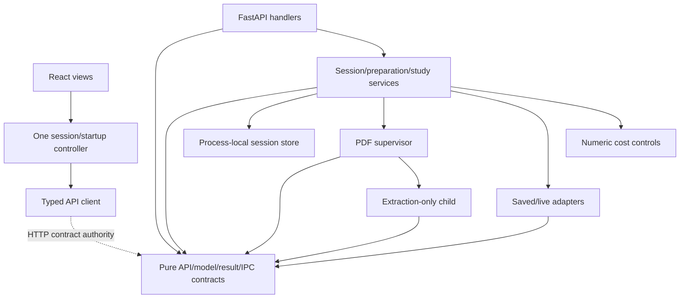

# Architecture — AI Study Buddy

## Purpose, authority and readiness

This is the shared technical foundation for Codex, other implementation agents, Camilla and the lecturer. Prefer a simple, achievable, maintainable IBE160 solution. The [final PRD](../../prds/prd-G89-halvorsen-2026-11-03/prd.md) and [addendum](../../prds/prd-G89-halvorsen-2026-11-03/addendum.md) govern behaviour; [DESIGN.md](../../ux-designs/ux-G89-halvorsen-2026-11-14/DESIGN.md) and [EXPERIENCE.md](../../ux-designs/ux-G89-halvorsen-2026-11-14/EXPERIENCE.md) govern the accepted UX. [technology.md](../technology.md) is the preferred reference, adapted rather than adopted wholesale.

**AD-1–AD-17 are adopted structural decisions.** The architecture planning and BMAD final review are complete. Exact schemas/runtime pins are owned bootstrap prerequisites; implementation and pre-live verification remain deferred gates, not reopened architecture choices. pypdf and Gemini/Vertex remain provisional candidates requiring the stated evidence.

**Current authorisation is documentation only:** no implementation, installations, builds, servers, images, credentials/accounts, model/provider/token/billing API calls, purchases or publication. Later work needs the user's authorising instruction; this document grants no transfer permission. Existing PDF trials do not certify the future app.

V1 has one temporary PDF session, fixed Bokmål/English output language and Brief/Detailed Summary level, an English interface, and no public launch, accounts, database, permanent ordinary study history or reload recovery. Navigation/restart reuse accepted content. PDF/model content is untrusted data, never authority, executable UI or tools. Before external transfer, visibly explain external processing/material restrictions and obtain active acknowledgement for each accepted upload, even the same file in a new session. Verify actual provider terms/settings before claiming no storage, training or retention; local cleanup does not delete provider copies. Keep credentials and study content out of ordinary app/SDK/error logs and exposed errors. Deliberately saved evaluation/demo evidence requires separate permissions, owner, access and review/deletion conditions.

## Design paradigm and dependency rules

A **client-server application with a modular monolith backend**: React owns presentation/practice; one FastAPI process owns application/session decisions. The short-lived PDF child isolates extraction, not another business service. Small functions/modules suffice; no generic framework is required. Below, DTO means data transfer object (a typed message), IPC means inter-process communication, and RSS means resident set size (observed physical process memory).



Arrows define allowed dependencies, not message order. Views dispatch intents through the controller, never create another session store or call providers. Handlers delegate to services. Services alone compose storage, supervisors, adapters, validation and cost controls. Adapters return data; they cannot mutate settings/session/practice state or publish. Contracts perform no network/file operations and import no services/bootstrap. Worker imports are limited to extraction and pure IPC DTOs: never application assembly, secrets, live adapters or session/cost state. Costs accept numeric accounting data only. Frontend types derive from backend contracts across HTTP, without Python imports.

## Adopted decisions

### AD-1 — Frontend and backend technologies [ADOPTED]

- **Binds:** Frontend, backend and project setup.
- **Prevents:** Independently selected frameworks/starters.
- **Rule:** Use React/TypeScript with Vite, starting from the official `react-ts` template, and a small Python/FastAPI application. One bootstrap owner pins compatible supported runtimes/dependencies before feature work.
- **Reason:** Preserve the reference's React/Python split with fewer frontend concepts than Next.js. Do not inherit unrelated databases, cache, storage or hosting services.

### AD-2 — Extract once; keep study state temporary [ADOPTED]

- **Binds:** Upload, learning functions, sources and state ownership.
- **Prevents:** Repeated parsing, durable study history and competing state owners.
- **Rule:** Accept one extraction snapshot per study session and reuse it. The single FastAPI process owns immutable physical-page text, fixed settings and current-upload acknowledgement under a fresh opaque identity. Each browser tab keeps identity, accepted content and practice/view state in React memory. Reload/closing restores nothing; backend restart loses workspaces. AD-14's numeric cost state cannot restore a session.

Retain the browser `File` only while startup/extraction needs it, including applicable manual retry; release it after accepted extraction, explicit rejection or session ending. Release backend raw/spooled uploads and parser handles on every outcome. Preserve the original device file. Source excerpts require no retained PDF viewer. No PostgreSQL, Redis or hosted object storage; multiple API owners would require a separate shared-state design.

- **Reason:** One temporary snapshot supports all learning/source flows without a database.

### AD-3 — Ended sessions cannot republish working state [ADOPTED]

- **Binds:** Ending, cancellation, request relevance and cleanup.
- **Prevents:** Late/cross-session output and abandoned copies.
- **Rule:** Confirmed New session synchronously clears browser identity/content/progress and returns empty startup; Cancel preserves everything. Backend ending is idempotent: invalidate before cancelling/deleting and release upload/parser/task-held copies. Reject unknown/ended identities without reconstruction. An unreachable cleanup request never restores frontend state; AD-10 expiry is the backstop.

Check current acknowledgement before transfer and current session/attempt before publication. Fetch cancellation assists cleanup; identity checks decide acceptance. Relevance belongs to the preparation/function attempt, **not the selected tab**: navigation/source opening does not cancel valid work or erase its cache. Newer explicit attempts, cancellation or session end may supersede it. Publication must not force navigation. Stale study output never prevents global cost settlement.

- **Reason:** Separate invalidation/publication authority from unreliable browser-close delivery. Blur alone does not end a session.

### AD-4 — Readable-text PDF processing [ADOPTED]

- **Binds:** Extraction, retained scope, source eligibility and omissions.
- **Prevents:** Guessing graphical content, retaining known corruption and blanket visual rejection.
- **Rule:** Keep **pypdf plain provisional**. Follow revised FR-40/FR-41, approved 26 November: use reliable, source-verifiable readable text despite missing graphical/table material. No OCR, advanced figure analysis, automatic parser/mode switching, blending or repair.

| Detected condition | Required outcome |
| --- | --- |
| Unsupported/protected/password-required/damaged input, fatal document/page-index decoding failure or configured resource excess | Reject/stop with detected reason and applicable next action; no unlocking or partial acceptance. |
| No meaningful usable text, e.g. only labels/noise/empty extraction | Stop as insufficient; do not infer a scan or impose an unsupported minimum rejecting useful short sources. |
| Uninterpretable image/figure/graphical lettering/table, but usable text remains | Continue from reliable text. Give evidence-based nonblocking omission notice, naming only observed classes/pages; no invented importance, content, OCR status or coverage percentage. |
| Some pages have no text | Preserve physical slots; use other usable text. Empty extraction alone proves neither blankness nor scanning; call blank only with supported structural evidence. |
| Identified unreliable fragment/table/cell association | Exclude the whole unsafe fragment/table, or whole page if that is the smallest reliably located boundary; warn and use remaining reliable text. Never reconstruct missing relationships. |
| Meaning-affecting corruption/order errors in retained main text cannot be isolated, or exclusions leave insufficient material | Stop with text problem and manual retry/another-PDF route. A replacement bullet/footer movement alone is insufficient. |
| Generic nonfatal diagnostic/plain-layout difference without demonstrated retained-text failure | Investigate internally; no automatic rejection or unsupported omission claim. |

Separate original per-page text, including excluded pages, from retained generation scope. Physical pages start at 1. Excluded content is never source-eligible. Match a nonempty excerpt on its cited page: exact first, then NFC plus collapsed whitespace. No translation, compatibility folding, punctuation/hyphen/case/number changes or fuzzy matching. Matching locates wording, not semantic support.

pypdf supplies no universal semantic graphic/table detector or verified region isolator. Raster/vector/Form signals can justify investigation/notices, not automatic rejection. Type3/pattern/soft-mask/annotation limitations are judged by retained-text effects. Unknown completeness alone is not a stop. No reviewed-demo whitelist or “continue anyway” override is required.

- **Reason:** Reliable readable text is useful without claiming whole-PDF coverage. Existing accuracy/source thresholds remain unchanged; historical blanket-coverage stops are superseded.

### AD-5 — One explicit OpenRouter generation path [ADOPTED]

- **Binds:** AI adapter, routing, credentials and retries.
- **Prevents:** Hidden calls, switches, fallback and key exposure.
- **Rule:** Use backend-owned HTTPX + Pydantic through OpenRouter, with one fixed model and explicit upstream endpoint. Restrict routing to that endpoint; disable transport/application retries, provider/model fallback, tools, output repair/regeneration/refill. One explicit generation/manual-retry attempt permits one outbound generation request. Strict local structure validation precedes source/current-request checks; publish no unvalidated fragments or silent demo substitution. Keys/routing remain backend-only.
- **Reason:** Retain the reference gateway while using a smaller explicit adapter instead of PydanticAI orchestration.

### AD-6 — Provisional model; evaluation before final adoption [ADOPTED]

- **Binds:** Candidate configuration, evaluation and final selection.
- **Prevents:** Advertised capabilities replacing educational evidence.
- **Rule:** Evaluate Gemini 3.5 Flash Lite through Google Vertex: `google/gemini-3.5-flash-lite`, proposed standard route `google-vertex/global`. Failure returns to a coached choice; no silent substitution or weakened criteria. Before separately authorised calls verify permissions, endpoint/account policies/settings, acknowledgement and all bounds.

Required evidence: 12 Summary cases (T1–T3 × both languages × both levels), six card cases and six Quiz cases (T1–T3 × both languages); a T1 pilot does not replace them. After the pilot, before full scoring/viewing outputs, freeze original-PDF readable-native-text coverage points: five Brief core points and ten Detailed eligible points. Brief must cover all five; Detailed must cover those five plus at least three additional points. Fix short-source adaptations and item/reference sampling/counting beforehand. Review every Summary factual claim; no unresolved known error passes. Preserve per-case correctness/support and same-item joint **9/10**, or all for smaller sets; inspect each reference and combined support from separate passages. Every displayed location/excerpt must verify. Record visual omissions separately; never remove missing expected text points after seeing results or derive the baseline solely from parser output.

Test actual strict schemas, Bokmål/English meaning/readability, all functions/levels, billed dimensions and total costs including failures/manual retests. Preserve permitted first outputs, failures, omissions and revisions of model/provider/prompt/schema/parser/configuration; changes require affected rechecks.

- **Reason:** The 26 November [endpoint catalog](https://openrouter.ai/api/v1/models/google/gemini-3.5-flash-lite/endpoints) advertised structured outputs, 1,048,576 context tokens and 65,536 completion tokens at US$0.30/US$2.50 per million input/output tokens. These are dated advertised capabilities, not app limits, account availability, Bokmål quality or tested fit.

### AD-7 — Whole retained text per generation [ADOPTED]

- **Binds:** Context assembly and source identities.
- **Prevents:** Hidden retrieval, truncated sources and lost references.
- **Rule:** Each explicit Summary/card/Quiz attempt receives the whole accepted retained original-language text with immutable app-owned physical-page markers. Separate instructions from untrusted text; generated aids never replace sources. No RAG/retrieval, separate input-selection model/tool pass or chunk/synthesis calls. The model may choose supporting citations within full supplied context, subject to source checks.

Before transfer, independently verify assembled text, instructions, markers, schema, reserved output/any reasoning against context and cost bounds. Character limits prove neither token count nor fit. Fail before transfer if full retained input cannot fit; never cut/select pages, lose identities, switch routes or add calls. Timeout/truncated/invalid output follows AD-13.

- **Reason:** Simple full context avoids a retrieval subsystem but repeats input cost and still needs quality evaluation.

### AD-8 — Input and generation limits [ADOPTED]

- **Binds:** Admission, preflight and generation deadlines.
- **Prevents:** Oversize inputs, hidden queues and indefinite generation.
- **Rule:** Backend enforces inclusive starting limits; frontend checks only assist.

| Bound | Value/behaviour |
| --- | --- |
| Uploaded PDF | 10 MiB = 10 × 1,024 × 1,024 bytes; no partial acceptance. |
| Physical pages | 50, including empty/textless pages; no first-pages truncation. |
| Retained generation text | 100,000 Unicode code points including whitespace, across retained pages. |
| Active generation | One admitted job; busy rejects without hidden queue. AD-12 shares its slot with upload/PDF work. |
| Generation | 120 seconds total from admission through response/source validation, not renewed per network read. |

- **Reason:** T1–T3 fit: largest measured 7,483,125 bytes/40 pages/74,990 characters. Values are operational choices, not measured model speed. Timeout cannot publish late output and does not prove provider processing/billing stopped. Limit failures preserve valid active content, without source cutting.

### AD-9 — Initial test budget and output ceiling [ADOPTED]

- **Binds:** Model configuration, evaluation and accounting.
- **Prevents:** Budget resets/growth and free-retry assumptions.
- **Rule:** **US$5 model/API usage total across the project**, not per session/function; **`max_tokens=8192` per attempt**. Verify reasoning/visible-output mapping; 8,192 visible tokens are not promised. Pin route and maximum rates US$0.30 input/US$2.50 output per million tokens. Unverifiable/higher rates or unavailable required parameters fail without fallback. No automatic increase or scheduled/session/reload/restart reset.

Before authorised tests configure a separate project key with provider-side US$5 lifetime usage limit/no reset and verify semantics. Reserve all input/output/other billed reasoning conservatively before transfer; account actual usage including failed/manual attempts. Hold unresolved reservations or pause live calls. In-flight safeguards are not universal; purchase fees/taxes are separate, so no absolute all-in cap is promised. If 8,192 tokens/US$5 cannot support the full PRD matrix/quality, record blocked cases and seek an explicit user decision; never reduce cases/thresholds or auto-regenerate.

- **Reason:** Bound the trial while making failed-attempt costs visible. An in-memory counter alone cannot enforce restart-safe spending.

### AD-10 — Renewable lease and orphan cleanup [ADOPTED]

- **Binds:** Access, renewal, wake, expiry and cleanup.
- **Prevents:** Abandoned copies and stale-ID revival without penalising quiet reading.
- **Rule:** Server owns time and checks expiry **before every access/renewal**. Renew only existing unexpired identities; client clocks/delayed heartbeats cannot override expiry.

| Adopted timing | Contract |
| --- | --- |
| Lease | 30 minutes since last server-accepted renewal/contact. No absolute four-hour cutoff. |
| Heartbeat | Every 60 seconds, independent of clicks/typing; best effort while hidden. Local control only, no study text/provider calls. |
| Cleanup | 30-second sweep plus five-second cancellation/release target, leaving margin for deletion within **31 minutes** after last accepted contact while service operates. Include task/parser/upload copies. |
| Wake/action | Check acknowledged validity before active reuse; validate if uncertain. Clear expired identity/content/progress and start afresh. |

Server work never renews itself. Blur does not end a session; suspended/disconnected browsers can lose it. The backend deadline is not guaranteed timed JavaScript erasure while suspended. New session invalidates immediately, without awaiting lease expiry. Verify scheduling/crash/cancellation and end-to-end deadlines before acceptance.

- **Reason:** A renewable finite lease supports quiet study and bounds orphans.

### AD-11 — Supervised short-lived PDF child [ADOPTED]

- **Binds:** PDF execution, IPC, process ownership and cleanup.
- **Prevents:** Stuck parsing blocking controls or retaining hidden copies.
- **Rule:** One fresh Python child per extraction attempt, asynchronously supervised using standard-library subprocesses. No process pool, additional API owner or external queue. Fixed application interpreter/worker and app-owned arguments, no shell, user-controlled commands/paths or pickle/shared session state; child has no credentials or provider access.

Parent owns registered child/attempt/deadline/uploads. Receive complete data-only JSON within a total byte cap before full buffering/decoding; `StreamReader.limit` is not that cap. Bound diagnostic drains without retaining raw stderr/source/PDF content. Accept only a complete valid physical-page map for the current attempt; discard partial, malformed, failed, oversize or stale output.

On timeout/cancel, terminate, wait within release budget and reap asynchronously. POSIX may escalate SIGTERM→SIGKILL; Windows terminate/kill both use TerminateProcess, not distinct escalation. Close all pipes/handles and release parent/task copies on every exit; never depend on killed-child `finally`. Parent death does not stop a child automatically: verify parent-loss detection, child lifetime and startup leftover cleanup. Only app-owned resources may be deleted.

- **Reason:** A stoppable process boundary preserves API responsiveness; threads cannot provide the same stop boundary. Clean exit alone proves neither valid text nor cleanup.

### AD-12 — PDF capacity and observed RSS bounds [ADOPTED]

- **Binds:** Resource admission, worker and control responsiveness.
- **Prevents:** Unbounded storage, hidden queues and false hard-memory promises.
- **Rule:** All bounds apply independently; never truncate to pass.

| Bound | Value/behaviour |
| --- | --- |
| Upload | 30 seconds total from admission to complete size-checked body; reserve before unbounded spooling. |
| PDF child | 30 seconds wall time from start attempt through complete bounded result, including start/transfer; progress does not reset it. |
| Heavy work | One shared upload/PDF-or-generation slot; never both. Controls/heartbeat/invalidation/cleanup remain outside it and long-held session locks. |
| Workspaces | Two total, counting reserved, active and awaiting cleanup; no silent eviction. |
| Original text | 1,000,000 code points including whitespace/excluded text across all pages, separate from retained-text cap. |
| Child result | 2 MiB UTF-8 JSON while receiving, before full decode; diagnostic drain separately bounded. |
| Child RSS | Stop at observed 256 MiB, inspect every 250 ms. Soft watchdog: sampling can overshoot, not a hard ceiling. |

Atomically reserve workspace/slot before body spooling; keep reservations until child/tasks/copies are released, including cleanup. Busy/full/oversize/timeout/RSS failures invalidate only the failed attempt, release copies and explain manual recovery; preserve unrelated valid content. Never block controls or release a running child's slot. Upload and parser clocks are separate, not a combined 30 seconds.

Verify live RSS bytes for the registered child's identity, handling exit races. Unreadable monitoring of a still-running child fails the attempt, never silently disables it. `psutil` is a candidate, not a selected dependency. Peak `ru_maxrss`/address-space `RLIMIT_AS` are not substitutes. Docker limits have different scope; no extra mandatory isolation service or hard-memory guarantee follows.

- **Reason:** Ordinary probe peaks ~55–71 MB/totals ~0.30–1.32 seconds motivate headroom, not worst-case or minimum-memory promises. Later tested adjustments preserve source/quality rules and AD-9's no-increase/reset restriction.

### AD-13 — Typed results with attached original sources [ADOPTED]

- **Binds:** Response validation, rendering, practice and source inspection.
- **Prevents:** Executable markup, incompatible payloads and lazy-source failures.
- **Rule:** Summary uses typed headings/paragraphs/lists and controlled safe emphasis; cards/Quiz use ordered typed records. Attach short verified sources for each accepted item/explanation/Summary passage in the same complete response. Model output cannot own identities, filename, settings, count, score or actions.

Validate whole required shape, strict fields/types/lengths, four options and answer keys first. Malformed structure rejects the whole reply. Any invalid reference withholds the whole new Summary. In an otherwise valid card/Quiz set, any invalid reference removes its **whole item**, even beside valid references. Deliver a nonempty valid subset with actual count/notice; zero usable items is an error/manual Try again. Publish result/sources/evidence-based notices atomically only for the current attempt. Failures preserve accepted content/progress; no automatic repair/refill.

Use app filename, immutable physical page and backend-resolved original-language text segments; separate contributing passages stay inspectable. Resolve NFC/whitespace matches to original text on the backend; no unlabelled Python/JavaScript offsets. Empty surrounding context is allowed. Render inert components: no HTML/CSS/Markdown interpretation, remote images, automatic links or model-directed actions. Source-grounded literal code/markup stays plain text.

Answer reveal/confirmation, draft/locked answers, C/N score, navigation/review/restart and View source use accepted memory records without generation or source-content fetch. Source close preserves a revealed card and restores trigger focus; function return keeps position but shows front. AD-10 wake/lease gates still apply. No PDF viewer/full-page download is needed.

- **Reason:** A small explicit contract fits the UX; repeated excerpts add bounded payload but avoid a general Markdown policy or lazy-loading lifecycle. Location/schema checks are not factual/language validation.

### AD-14 — Durable costs without study history [ADOPTED]

- **Binds:** Restart-safe accounting, reconciliation and Git exclusion.
- **Prevents:** Forgotten charges and cost controls retaining study/personal data.
- **Rule:** Parent alone owns `.local/ai-study-buddy-costs/budget.json`: known project cost amounts and pending reservations only. Exclude filename, study/session identity, prompts/excerpts/content/progress, personal identifiers/IP/timestamps/provider IDs/key fingerprints/credentials. Never restore study state or reset/delete costs on session cleanup/reload/restart. Ignore the entire directory, including lock/atomic sidecars; never stage/push it.

Use atomic updates and exact/conservatively rounded-up amounts. Missing expected/corrupt schema/version state never silently becomes zero. Persist reservations before transfer; record actual account charges even for failed/stale/ended study attempts. Release only reconciled unused amounts. Delayed/unknown settlement stays held or blocks live attempts. Numeric accounting must not retain study tasks/objects for settlement. The file supplements, not replaces, provider lifetime limits or spending permission. Demo remains usable without key, provider-budget request or cost-file initialisation; setup/reconciliation stays outside learning UI.

Before live use verify all billed dimensions/context independently. Earlier baseline calculation: `1,048,576 × $0.30 / 1,000,000 + 8,192 × $2.50 / 1,000,000 = $0.3350528`. **US$0.35 is only a conditional reservation seed:** the combined conservative upper bound for every billed dimension must fit within it. Otherwise stop for review; never silently enlarge it or AD-9's budget. It is not spending authority, input-fit proof or an all-in guarantee. Reconcile documented account `usage.cost`, not model text/upstream cost estimates; verify lifetime usage/reset/remaining allowance and settlement delays. No exact tokenizer or character-to-token guarantee is assumed; resolve unsupported accounting before transfer without silently adding external checks.

- **Reason:** A tiny content-free file preserves budget state without a database/history. Unknown cost pauses live generation, not the key-free demo.

### AD-15 — Native and optional Docker delivery [ADOPTED]

- **Binds:** Local development, demonstration and packaging.
- **Prevents:** Mandatory Docker, divergent demos, private image content and reset budgets.
- **Rule:** Develop with Vite plus one FastAPI API process. Native demo serves built frontend/API on loopback/same origin; no separate Node runtime after build. README documents prerequisites/build/start; ignored `dist/` is not delivered automatically by cloning. Verify serving API precedence/client routing with chosen versions.

Optional Docker uses one multi-stage image: Node/Vite build then Python runtime with backend, built UI and approved demo assets. One service/Compose wrapper or equivalent command; non-root runtime, signal forwarding/init and tested bounded shutdown. Publish only host loopback; internal listening address is separate. No database/cache/proxy/API-worker stack.

Both paths default to clearly labelled saved playback: one approved shareable PDF, Brief/Detailed summaries and cards/Quiz in both languages. Load only selected variants; changed choices require New session. Same UI/validation/source rubric. Build/start/health/core demo require no key/paid account/provider/token/budget request or live cost-file initialisation. An environment key cannot silently enable live mode. Missing/invalid variants or own-PDF/fresh-generation requests get honest existing info/error treatment, never wrong variants/fallback, mode selector or credential form. T1–T3 are not approved demo assets.

Before building, `.dockerignore` plus narrow COPY allowlist must exclude private PDFs/extractions, secrets/`.env`, cost directory/sidecars, `.git`, logs and unrelated planning/caches **before context transfer/caching**. Git exclusion or later-layer deletion is insufficient. No remote build service/image publication is adopted.

Scratch must be ephemeral, e.g. supported tmpfs; no ordinary study-data volume. Container stop does not erase its writable layer. Test graceful stop/kill/restart/parent loss and cleanup; init/reaping does not replace supervision. Later authorised live Docker use explicitly mounts the existing cost **directory** outside image/writable layer so replacement/reservations survive recreation; demo needs no mount. Only one live API instance per project, native or container. Preserve soft child-RSS semantics; container/VM memory limits prove neither native parity nor a hard child cap.

- **Reason:** Optional packaging supports the lecturer/examiner while native development stays small. Retain only relevant Docker patterns from the reference. First setup may download public dependencies/base images; no internet-free first-install claim.

### AD-16 — Native macOS and Windows targets [ADOPTED]

- **Binds:** Native startup and delivery verification matrix.
- **Prevents:** Unix-only setup or container success masquerading as Windows support.
- **Rule:** Target macOS and Windows native key-free demo with equivalent portable documented commands. Native Linux is not another required target; optional Docker is the Linux-container package on documented hosts/CPUs. Verify setup/build/start, both languages/levels, sources, ending/expiry, upload/IPC/RSS limits, cancellation/forced stop/parent loss/temp cleanup on each native target; verify numeric atomic cost operations separately using content-free owned fixtures.

Use one API process/no autoreload for demo. Windows async subprocesses require Proactor; Uvicorn reload/multi-worker configurations can select incompatible Selector. Baseline Windows development uses manual backend restart plus Vite HMR until an alternative is verified. No silent loop dependency/thread parser substitution. Pin and test effective loop, process/signal/filesystem-lock/replace/timing behaviour; Unix assumptions do not establish Windows support.

- **Reason:** Cover student/examiner hosts with one codebase. Minimum OS/CPU versions, images and actual launch/support proof remain owned gates.

### AD-17 — Staged startup and one-shot intent [ADOPTED]

- **Binds:** Startup controller, local protocol, preparation and initial generation.
- **Prevents:** Uncancellable uploads, worker-triggered paid calls and duplicate/stale continuations.
- **Rule:** One Generate Summary action registers app-owned workspace/attempt identity before body processing, uploads/checks bounded input and starts one tracked parent-owned preparation task. Parent owns raw copy before request upload handles close. Read-only status reports actual phase; it starts no work/model call. Source ready follows full source/resource validation and child/raw cleanup. Only the still-current browser intent requests the one initial Summary attempt, never worker completion.

Reservation starts the existing 30-second upload clock; abandoned pre-body capacity cannot wait for lease expiry. Release preparation resources only after relevant child/copies clear. Keep separate parser/generation clocks. If another job wins the slot, preserve snapshot and require manual Try again, not polling retry/queue. Consume continuation once; backend rejects duplicate admissions. Ending/expiry/reload invalidates pending continuations/polls; check relevance before any mutation. Transfer still checks acknowledgement, scope, context/cost and current request; server work cannot renew lease.

- **Reason:** Small local requests expose ownership/cancellation/billing without extra student steps, external queue, SSE requirement or partial model streaming. Show actual operations, not fake progress; saved loading never pretends to extract/generate live.

## Bootstrap contract and deferred gates

Planned paths, not files created now:

```text
frontend/src/{app,api,features}/  controller; typed client; learning/source views
backend/app/
  main.py                      assembly/routes/built UI
  contracts.py                 pure API/model/result/IPC DTOs
  sessions.py                   identities/leases/admission
  preparation.py                upload/status/source-ready
  pdf_jobs.py, pdf_worker.py    supervisor; isolated extraction
  study.py, generators.py      validation/publication; saved/live adapters
  costs.py                     numeric accounting only
demo/                          permitted PDF/saved variants
scripts/                       portable setup/build/start verification
```

The **bootstrap owner first** pins compatible Python/Node/package/image baselines and canonical lock/version files. The **backend contract owner then**, before parallel dependent features, publishes pure Pydantic schemas, OpenAPI export and corresponding frontend types. This explicitly includes child IPC request/result DTOs consumed by supervisor/worker, untrusted model candidates versus accepted app results, lease wire clock/unit semantics, endpoint/phase/error fields, lengths, schema versions and generator tooling. Workers may import pure IPC types, never application/bootstrap/secrets. Contract changes update server/frontend/demo together and pass affected checks.

Canonical conventions: UTF-8 JSON/camelCase wire names (Python aliases may be snake_case); opaque app-owned session/attempt strings, never filenames/cache identities. Functions `summary|flashcards|quiz`, languages `nb|en`, levels `brief|detailed`; fixed server settings, level affects Summary only. Pages 1-based; backend counts code points including whitespace, UTF-8 bytes separately, RSS bytes and MiB=1,024² bytes. Publish original context/highlight segments, not raw model quotations/unlabelled offsets. Common responses carry current relevance and complete accepted result/sources/notices or safe typed failure. Ended/expired clears ended state; busy/operation/validation/setup preserves valid active state. Parser/provider payloads are not UI errors. Freeze Quiz indexing/keys and source-error classification before parallel work; actual counts/scores derive from accepted items.

| Deferred item | Owner | Required trigger/gate |
| --- | --- | --- |
| Exact runtime/dependency/image pins, starter snapshot and launch/proxy/origin rules | Bootstrap owner | Before feature code depends on them; no independent `latest`. |
| API/model/result/child-IPC schemas, lease semantics, lengths/versions/types | Backend contract owner | Before parallel frontend/adapter/worker work; consume one canonical contract. |
| Reliable-text isolation, IPC/RSS reader, forced-stop/parent-loss and atomic-file mechanics | Integration owner | Verify owned negative/boundary fixtures and cleanup/platform deadlines before accepting implementation. |
| Permitted PDF, all reviewed saved variants and README workflows | Demo owner | Before claiming native/Docker examiner readiness; same content/source rubric. |
| Endpoint/account terms, complete-request context/cost reservations, settlement and PRD model evaluation | Integration/evaluation owner | Separate user authorisation before calls; verify gates before enabling/finally adopting live candidate. |
| Minimum OS/CPU/image support and assignment/deadline/reflection evidence | Delivery owner | Before support/delivery claims; preserve PRD's educational follow-ups. |

## Dated evidence and review

On 26 November, isolated Python 3.14.7/pypdf 7.1.1/pdfplumber 0.11.11 trials preserved all 74 T1–T3 page slots; original hashes were unchanged. PDFium renders were surveyed, with full-page samples. Native text was feasible, but **complete coverage failed**: both parsers missed substantive diagrams/graphical text; pdfplumber ordering/table recovery was mixed. Source-location and owned synthetic tests exercised Unicode/whitespace, page identity and rejection cases, not semantic support, generated quality or app cleanup. Probe versions are evidence, not application pins; recheck affected fixtures after bootstrap choices. Keep extracted outputs outside the repository.

See [sanitized parser evidence](checks/pdf-feasibility-2026-11-26.json), [structural signals and limitations](checks/coverage-signals-2026-11-26.json), [parser probe](checks/probe.py) and [owned fixture probe](checks/synthetic_probe.py). Structural assertions are not a semantic detector. BMAD [rubric](reviews/review-rubric-condensed.md), [adversarial](reviews/review-adversarial-condensed.md) and [technology](reviews/review-tech-reality-condensed.md) reviews found no critical/high structural blocker; their implementation/pre-live gates remain binding.

Primary references underpinning the choices: [Vite starter](https://vite.dev/guide/) and [static builds](https://vite.dev/guide/static-deploy.html); [FastAPI](https://fastapi.tiangolo.com/tutorial/) and [frontend serving](https://fastapi.tiangolo.com/tutorial/static-files/); [Pydantic strict validation](https://docs.pydantic.dev/latest/concepts/strict_mode/) and [extra fields](https://docs.pydantic.dev/latest/api/config/#pydantic.config.ConfigDict.extra); [HTTPX transports](https://www.python-httpx.org/advanced/transports/); OpenRouter [structured outputs](https://openrouter.ai/docs/guides/features/structured-outputs), [routing](https://openrouter.ai/docs/guides/routing/provider-selection), [token parameters](https://openrouter.ai/docs/api_reference/parameters#max-tokens), [reasoning](https://openrouter.ai/docs/guides/best-practices/reasoning-tokens), [key limits](https://openrouter.ai/docs/api_reference/limits) and [account cost](https://openrouter.ai/docs/cookbook/administration/usage-accounting); Python [subprocesses](https://docs.python.org/3.14/library/asyncio-subprocess.html) and [Windows](https://docs.python.org/3.14/library/asyncio-platforms.html#subprocess-support-on-windows); [Uvicorn loops](https://uvicorn.dev/concepts/event-loop/); [psutil RSS candidate](https://psutil.io/7.2/#psutil.Process.memory_info); Docker [multi-stage](https://docs.docker.com/build/building/multi-stage/), [context exclusions](https://docs.docker.com/build/concepts/context/#dockerignore-files), [storage](https://docs.docker.com/engine/storage/) and [resource scope](https://docs.docker.com/engine/containers/resource_constraints/). These links support feasibility, not completed implementation or current-account guarantees.
